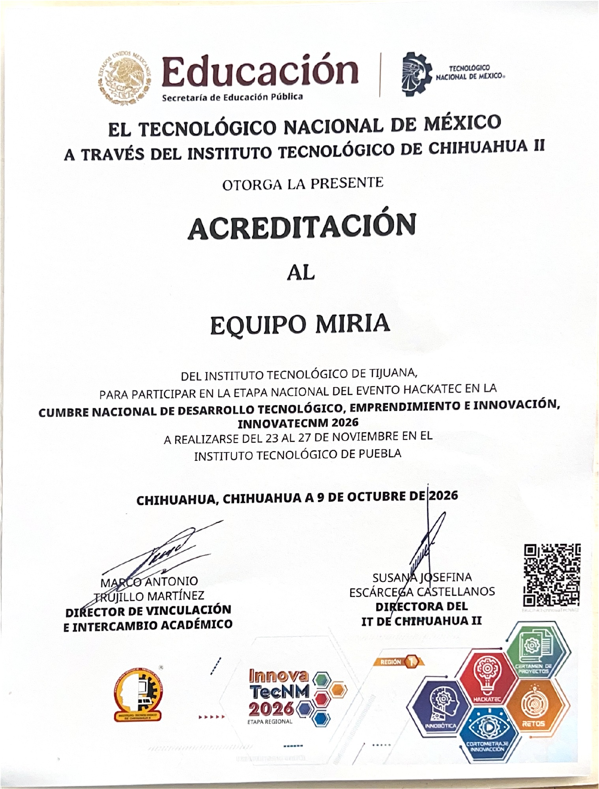

# Irving García

**Interfaces web · Python · Proyectos con impacto social**

Soy estudiante de **Ingeniería en Inteligencia Artificial** en el **Instituto Tecnológico de Tijuana**. Estoy construyendo experiencia en desarrollo de software mediante proyectos académicos y trabajo en equipo. Me interesan el diseño de interfaces, la tecnología aplicada a problemas reales y el cómputo en la nube.

**Integrante del equipo MIRIA, acreditado para la etapa nacional de HackaTec en InnovaTecNM 2026.** Mi trayectoria en esta edición incluye un segundo lugar en la etapa local universitaria y la clasificación a la nacional tras participar en la etapa regional en Chihuahua.

## Proyecto destacado

### B.A.W.Í. — Agua, talento y comunidad

Proyecto desarrollado con el **equipo MIRIA** que aborda el uso del agua en la agricultura y el intercambio de conocimiento entre productores. Integra áreas de riego, comunidad y capacitación.

**Mi aportación**

- Prototipos visuales en HTML para las interfaces de comunidad, login y perfil.
- Diseño de navegación, publicaciones y presentación visual de la comunidad.
- Propuestas de dinámicas educativas y un sistema de puntos para apoyar el aprendizaje y la participación.

Mi trabajo se centró en el prototipado de interfaces y las propuestas de capacitación. La implementación del sistema completo fue un trabajo de equipo.

[Explorar el repositorio del equipo](https://github.com/LuisRamon21/ProyectoMirIA-HackaTEC)

## Herramientas y aprendizaje

| Área | Experiencia y enfoque |
|---|---|
| HTML y CSS | Prototipos e interfaces web. |
| Python | Prácticas de programación, algoritmos y estructuras de datos. |
| Git y GitHub | Aprendizaje de control de versiones y colaboración. |
| Cómputo en la nube | Formación académica y exploración de servicios en la nube. |

## Logros y participación en eventos

| Fecha | Etapa y sede | Resultado o estado |
|---|---|---|
| Mayo de 2026 | Etapa local · Instituto Tecnológico de Tijuana | **2.º lugar** y clasificación a la etapa regional. |
| Octubre de 2026 | HackaTec · Etapa regional, Instituto Tecnológico de Chihuahua II | Participación con el **equipo MIRIA**, proyecto B.A.W.Í., y **acreditación para la etapa nacional**, emitida el 9 de octubre. |
| 23–27 de noviembre de 2026 | HackaTec · Etapa nacional de InnovaTecNM, Instituto Tecnológico de Puebla | **Equipo acreditado; participación próxima.** |

Sede y fechas de la etapa nacional: [anuncio oficial del Instituto Tecnológico de Puebla](https://www.puebla.tecnm.mx/puebla-sera-sede-de-innovatecnm-2026/).

### Acreditación a la etapa nacional

El Tecnológico Nacional de México, a través del Instituto Tecnológico de Chihuahua II, otorgó al **equipo MIRIA del Instituto Tecnológico de Tijuana** la acreditación para participar en la etapa nacional de **HackaTec, InnovaTecNM 2026**. Documento expedido en Chihuahua el **9 de octubre de 2026**.

Ver acreditación del equipo MIRIA

  

[Consultar el documento completo en PDF](acreditacion-hackatec-nacional-2026.pdf)

## En qué estoy trabajando

- Documentar mis proyectos para que otras personas puedan comprenderlos y utilizarlos.
- Mejorar mis habilidades de desarrollo de interfaces y programación en Python.
- Aplicar lo aprendido en proyectos colaborativos y soluciones útiles.

---

[Perfil de GitHub](https://github.com/Irvingggl)

